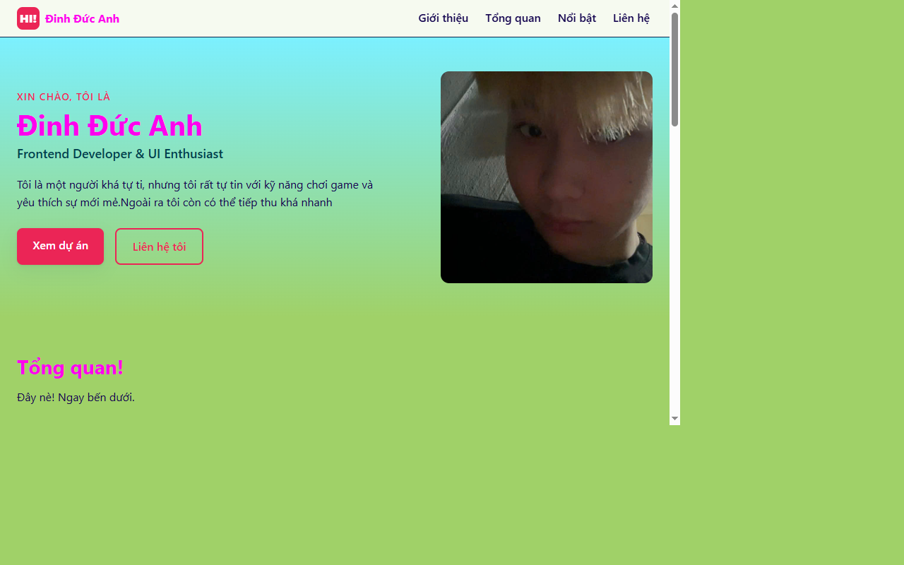
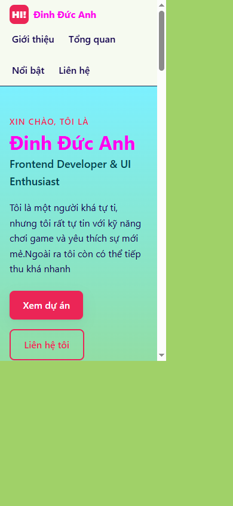

# Báo cáo kiểm thử - Portfolio CV cá nhân

- **Phiên bản:** v1.0
- **Ngày kiểm thử:** 2026-10-27
- **Phạm vi:** Website tĩnh HTML/CSS, mở từ tệp `index.html` trong trình duyệt tích hợp VS Code.
- **Minh chứng:** Ảnh chụp giao diện được lưu trong [`docs/screenshots/`](screenshots/).

## 1. Tính đúng đắn - Đạt có điều kiện

- Trang mở được và hiển thị đúng tiêu đề “Đinh Đức Anh ĐZ · Frontend Developer”.
- Các mục điều hướng nội bộ (`#top`, `#about`, `#skills`, `#projects`, `#contact`) đều có phần tử đích tương ứng.
- Cả 5 ảnh đang được tham chiếu đều tải thành công; liên kết email sử dụng `mailto:`.
- **Cần kiểm tra thêm:** Thử nghiệm click tự động vào mục “Liên hệ” trên thanh điều hướng mobile bị phần tử `ul.nav-list` nhận hit-test thay cho liên kết. Chưa xác nhận được thao tác này trên thiết bị/trình duyệt thực.
- Các liên kết “Xem chi tiết” và hồ sơ GitHub/LinkedIn trong trang hiện dùng `href="#"`, chưa dẫn đến nội dung/hồ sơ thật.

## 2. UI/UX - Đạt một phần

- Bố cục có các điểm responsive; ảnh chụp minh chứng gồm kích thước 1280×800 và 390×844.
- Điều hướng, phần giới thiệu, thẻ nội dung, liên hệ và chân trang được trình bày thành các vùng riêng.
- Nội dung một số thẻ còn mang tính mẫu/cá nhân, bảng màu có độ rực cao; cần rà soát độ tương phản và tính nhất quán trước khi phát hành chính thức.
- Tương tác điều hướng trên mobile cần được kiểm tra lại do kết quả hit-test nêu ở tiêu chí Tính đúng đắn.

## 3. Khả năng vận hành - xử lý lỗi - Đạt trong phạm vi kiểm tra

- Website tĩnh hiển thị trực tiếp từ `index.html`; các tài nguyên ảnh và CSS cục bộ được tải trong lần kiểm tra.
- Dự án không có JavaScript nên không có luồng xử lý lỗi runtime phía client để kiểm thử.
- Chưa kiểm thử tình huống mất tài nguyên, lỗi máy chủ HTTP hoặc log trên nhiều trình duyệt/hệ điều hành.

## 4. Bảo mật - Chưa kiểm thử chuyên sâu

- Kiểm tra sơ bộ cho thấy trang không nạp thẻ `<script>`, không có biểu mẫu nhập liệu và không gửi dữ liệu đến backend.
- Không phát hiện bí mật/credential trong phạm vi trang đã kiểm tra.
- Chưa chạy công cụ quét lỗ hổng, kiểm thử bảo mật headers, cấu hình HTTPS hoặc kiểm thử triển khai production. Kết quả này không thay thế một đợt đánh giá bảo mật đầy đủ.

## 5. Chất lượng mã nguồn - Đạt cơ bản

- HTML có cấu trúc ngữ nghĩa như `header`, `nav`, `main`, `section`, `article`, `footer`; có khai báo ngôn ngữ và văn bản thay thế cho ảnh.
- CSS được tách riêng, dùng biến CSS, Flexbox, Grid và media query.
- Chưa có bộ kiểm thử tự động, formatter/linter hoặc kiểm tra accessibility tự động trong dự án.
- Một số `alt` ảnh và nội dung thẻ vẫn dùng mô tả mẫu; cần đồng bộ với nội dung thực tế.

## 6. Khả năng triển khai - Đạt có điều kiện

- Có thể triển khai như website tĩnh lên hosting hỗ trợ HTML/CSS hoặc phục vụ bằng web server như Nginx.
- README có hướng dẫn chạy cục bộ và Docker; các bước Docker chưa được thực thi trong đợt kiểm thử này.
- Dự án chưa có Dockerfile, pipeline CI/CD, tên miền hoặc cấu hình HTTPS; các nội dung này phụ thuộc môi trường triển khai.

## Ảnh minh chứng

Ảnh được chụp trực tiếp từ trang đang chạy cục bộ bằng trình duyệt tích hợp:

### Giao diện desktop (1280×800)

### Giao diện mobile (390×844)

Ảnh chụp toàn trang:

- [Desktop](screenshots/desktop.png)
- [Mobile](screenshots/mobile.png)
